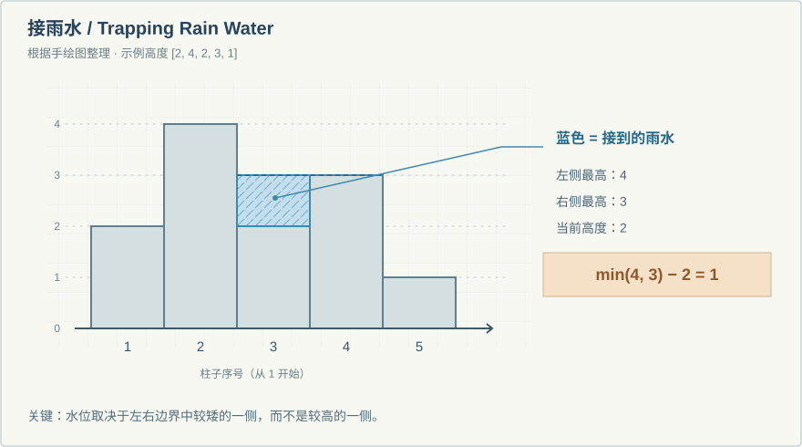

# 写随笔

## LeetCode 笔记命名规则

统一使用 `leetcode-hot100-day-序号-主题.md`，全小写，用短横线分隔，序号补足三位。

- 第一篇：`leetcode-hot100-day-001-hash-table.md`
- 后续示例：`leetcode-hot100-day-002-two-pointers.md`
- 后续示例：`leetcode-hot100-day-003-sliding-window.md`

后续示例的主题仅用于展示命名方式，按实际学习内容填写即可。日期写在文章顶部的 `date` 中。文件名决定网址，正式发布后尽量保持不变；修订内容时无需改名。

## 编写和预览

1. 复制 `_template.md`，改名为 `my-first-note.md`。文件名使用英文字母、数字和短横线，它会成为文章网址的一部分。
2. 修改顶部的 `title`（标题）、`date`（YYYY-MM-DD）、`summary`（一句话摘要）。正文使用 Markdown，中英文都支持。
3. 写作时保留 `draft: true`，发布时改成 `draft: false`。
4. 本地预览前运行 `python scripts/build_notes.py`，再刷新首页。首次使用需要 `python -m pip install -r requirements.txt`。
5. 提交并推送后，GitHub Actions 会自动生成文章页面和首页目录。需要按项目 README 启用 Actions 部署。

不要修改生成的 `notes/` 页面或 `data/notes.json`，下次构建会覆盖它们。删除或重新设为草稿的文章，会在下次构建时移出网站。

图片统一放在 `posts/images/`，建议每篇文章一个子文件夹，例如 `posts/images/day-007/trapping-rain-water.svg`。Markdown 中用相对路径：

```markdown

```

这样在编辑器中也能预览；构建器会自动调整文章网页里的路径，部署时只复制图片文件夹，不会上传整个 `posts/` 源文件目录。后续也可以放 PNG、JPG、WebP 等图片。

首页每页显示 5 篇笔记，按 `date` 从新到旧排列；同一天按文件名倒序，因此补零的 Day 007 会排在 Day 006 前面。点击 **Older notes** 看旧笔记，**Newer notes** 返回新笔记。日期以文章头的 `date` 为准，不以 Git 推送时间排序。

不要将私人草稿提交到公开仓库：`draft: true` 只控制网站展示，不会隐藏仓库里的源文件。

文件名前缀 `_`、本说明文件及 `draft: true` 的文章都不会发布。尚未写文章时，首页保留空状态，不会把模板当成你的随笔。
