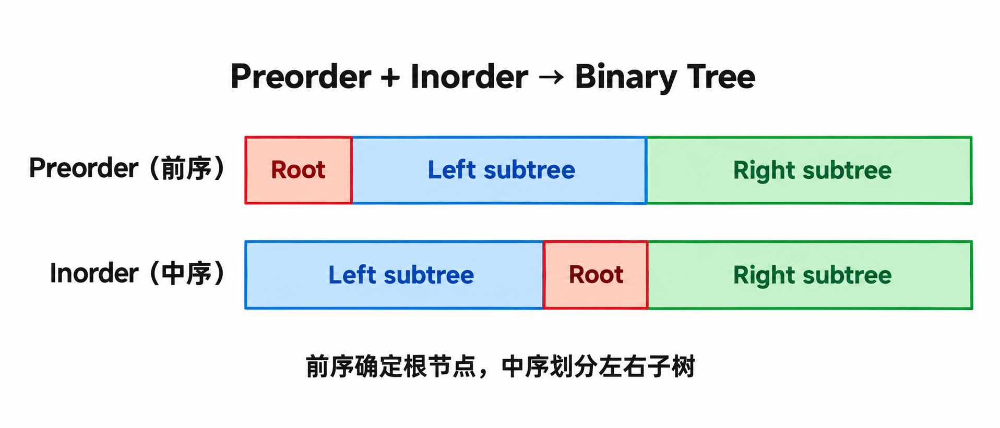

## 102. 二叉树的层序遍历 · BFS（广度优先搜索）

从上到下、从左到右返回每一层的节点值。

```python
from collections import deque


class Solution:
    def levelOrder(self, root):
        if root is None:
            return []

        q = deque([root])
        res = []

        while q:
            sz = len(q)
            level = []

            for _ in range(sz):
                curr = q.popleft()

                if curr.left:
                    q.append(curr.left)
                if curr.right:
                    q.append(curr.right)

                level.append(curr.val)

            res.append(level)

        return res
```

- 每层开始时固定 `sz`，确保本轮只处理当前层，不处理新加入的下一层节点。
- 原逻辑正确，`none` 改为 `None`。
- 时间 O(N)，辅助空间 O(W)，不计结果数组；W 为最大层宽。

## 199. 二叉树的右视图 · BFS（广度优先搜索）

返回从右侧观察二叉树时，每一层能看到的节点值。

先右后左入队，每层第一个节点就是该层最右侧节点。

```python
from collections import deque


class Solution:
    def rightSideView(self, root):
        if root is None:
            return []

        q = deque([root])
        res = []

        while q:
            sz = len(q)
            first = q[0]

            for _ in range(sz):
                curr = q.popleft()

                if curr.right:
                    q.append(curr.right)
                if curr.left:
                    q.append(curr.left)

            res.append(first.val)

        return res
```

- 你的遍历逻辑正确；将 `last` 改名为 `first`，只是让名称符合“每层第一个节点”的含义。
- 先右后左取每层第一个；先左后右则取每层最后一个。
- 时间 O(N)，辅助空间 O(W)，不计结果数组。

## 105. 从前序与中序遍历序列构造二叉树 · Recursion（递归）

根据节点值互不相同的前序和中序遍历序列，还原二叉树。

前序第一个元素确定根节点；根在中序中的位置确定左右子树范围。



- 前序：根 → 左子树 → 右子树。
- 中序：左子树 → 根 → 右子树。
- 前序确定根，中序划分左右，子树内部递归重复这个过程。

```python
class Solution:
    def buildTree(self, preorder, inorder):
        self.valtoindex = {}

        for i in range(len(inorder)):
            self.valtoindex[inorder[i]] = i

        return self.build(
            preorder, 0, len(preorder) - 1,
            inorder, 0, len(inorder) - 1
        )

    def build(self, preorder, prestart, preend,
              inorder, instart, inend):
        if prestart > preend:
            return None

        rootval = preorder[prestart]
        index = self.valtoindex[rootval]
        leftsize = index - instart

        root = TreeNode(rootval)

        root.left = self.build(
            preorder, prestart + 1, prestart + leftsize,
            inorder, instart, index - 1
        )
        root.right = self.build(
            preorder, prestart + leftsize + 1, preend,
            inorder, index + 1, inend
        )

        return root
```

- 你的递归区间划分正确，`leftsize` 表示左子树的节点数。
- `treenode` 改为 `TreeNode`；字典放在入口初始化，替代未写完整的 `__init__`。
- 时间 O(N)，空间 O(N)，包括索引字典与递归栈。

## 114. 二叉树展开为链表 · Postorder（后序）

将二叉树原地展开为符合前序遍历顺序的链表：所有左指针为空，右指针指向下一个节点。

先展开左右子树，再把左链接到根的右侧，最后将原右链接到左链末尾。

```python
class Solution:
    def flatten(self, root):
        if root is None:
            return

        self.flatten(root.left)
        self.flatten(root.right)

        left = root.left
        right = root.right

        root.left = None
        root.right = left

        p = root
        while p.right:
            p = p.right

        p.right = right
```

- 原来的连接逻辑正确，主要修正 `None` 的大小写。
- 处理发生在后序位置，但最终链表顺序是前序：根 → 左子树 → 右子树。
- 每次都扫描展开后的左链寻找末尾，最坏时间 O(N²)；递归栈空间 O(H)，H 为树高。